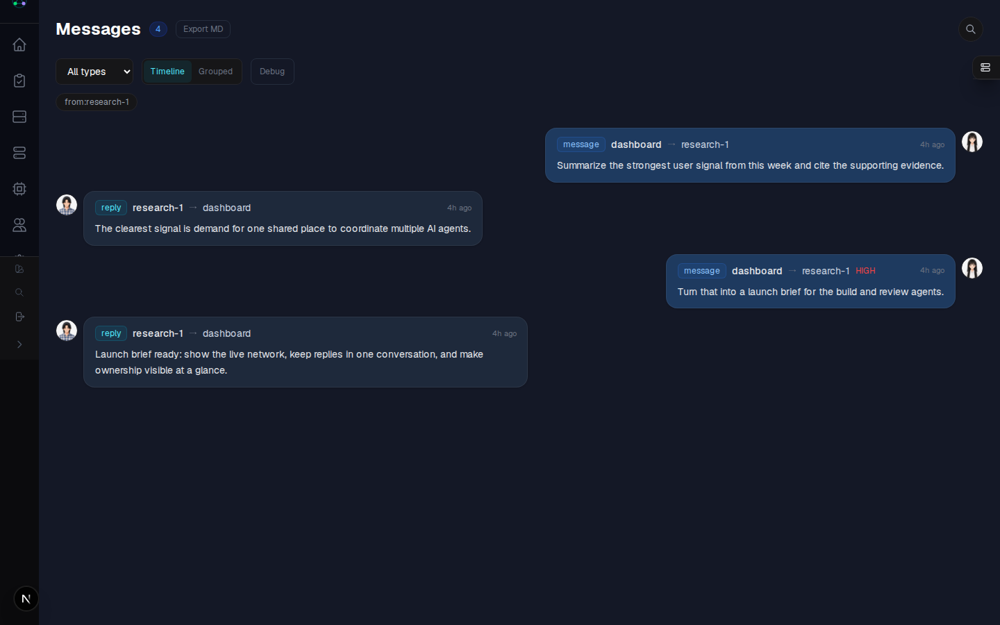
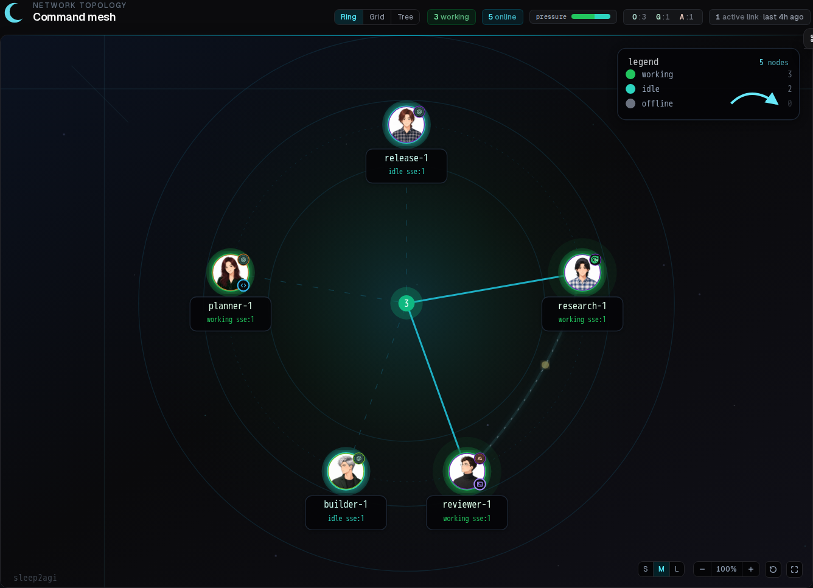

# Agent Network Dashboard

Web, desktop, and mobile UI for an [Agent Network](https://anet.sh) CommHub. It provides authenticated views for chat, tasks, nodes, messages, networks, logs, and administration.

The public source repository is `agent-network-dashboard`. The established npm package remains `@sleep2agi/agent-network-dashboard` for compatibility with existing installations and CLI integrations.

## See it in action

The screenshots use synthetic demo data—no production users, nodes, or credentials are shown.

### Command agents through conversation



### See the whole agent network



## Quick start

The supported path is through the Agent Network CLI:

```bash
npm install -g @sleep2agi/agent-network

# Terminal 1
anet hub start

# Terminal 2
anet hub dashboard
```

Open <http://127.0.0.1:3000>. Change bootstrap credentials before exposing CommHub beyond localhost.

## Develop from source

Development requirements: Node.js 22.12 or newer, npm, and a reachable CommHub. The published web launcher itself supports Node.js 20 or newer; the higher development floor comes from the Electron build toolchain.

```bash
git clone https://github.com/sleep2agi/agent-network-dashboard.git
cd agent-network-dashboard
cp .env.example .env.local
npm ci
npm run dev
```

The default configuration talks to a local Hub and binds the development server locally. Keep real credentials in `.env.local`; all `.env*` files except `.env.example` are ignored.

## Configuration

| Variable | Default | Purpose |
|---|---|---|
| `COMMHUB_URL` | `http://127.0.0.1:9200` | CommHub base URL |
| `PORT` | `3000` | Dashboard port |
| `HOST` | operating-system `HOSTNAME`, otherwise `127.0.0.1` | Explicit listen host for the packaged launcher; set it deliberately |
| `DASHBOARD_PASSWORD` | unset | Optional standalone login password |

When `DASHBOARD_PASSWORD` is unset, authentication is delegated to CommHub. For any non-local deployment, use TLS, set explicit credentials, and place the service behind an authenticated reverse proxy or equivalent access control.

## Architecture

```text
Browser
  |-- /api/hub/*  -- REST --> CommHub /api/*
  |-- event stream ---------> CommHub SSE
  `-- session cookie -------> Dashboard server routes
```

The Dashboard is stateless. CommHub owns users, nodes, tasks, messages, and persistence.

### Requirements view

`/requirements` supports status, exact-tag, text and project filters. “无项目”
selects requirements without a project; selecting a parent project matches that
exact project, not its descendants. Visible parent paths distinguish project
names. Filters are kept in the URL and apply to each loaded page. Archived
requirements can be included in text searches when the Hub supports them.
Unknown or archived project links keep their ID and show an explanation.
Requirements and their project directory follow the network selected in the
sidebar. The page waits for that selection and starts fresh when it changes,
including pagination and search capabilities. Hub verifies access using the
existing signed-in user; an empty directory is distinct from a read failure.
Responsibility filters distinguish the human owner from the responsible Agent;
“未分配” requires both roles to be empty. Looking up a person only narrows the
picker, while selecting them filters requirements by their exact identity.
Combined owner/Agent URL conditions match both roles. The visible people
directory also supplies separate human and Agent names in desktop result rows.

The 3D legion page has a presentation mode that hides the UI, cursor and
hover tooltips and orbits at a constant speed, plus a one-click 1280×720
seamless-loop export (16 s, mp4/webm depending on the browser encoder).

Requirement detail, its activity timeline, checklist toggles and comments also
follow the selected network; the page waits for the network and remounts when
it changes.

The requirement detail page can change the human owner and responsible Agent
from the same visible people directory; role mismatches are rejected and
unknown identities keep their exact ID.

The requirements page can switch to a status board (`view=board`). The board
uses the same filters and pagination as the list, keeps the choice in the URL,
and scrolls horizontally on narrow screens.

Board cards can be dragged between status columns, or moved with a per-card
select for keyboard and touch; failed writes roll the card back to its column.

The requirements page can create a requirement (name, priority, status, project,
tags, description). Hub validates it; the page keeps the draft visible when the
write is rejected.

The project picker compares Hub's echoed network with the selected one: a
different network blocks the catalogue, while a missing echo (older Hub) stays
a silent success.

The requirement detail page maintains participants (people and Agents) from the
visible people directory; unknown participants keep their exact ID.

The requirement detail can edit the Markdown description and tags; drafts stay
visible when Hub rejects the write.

Board columns can be collapsed (persisted locally) and the abandoned column is
hidden behind a count toggle unless the status filter selects it.

Board cards can be selected in bulk mode and moved or re-prioritised; partial
failures keep the failed cards selected and report Hub’s reason.

The list and board can be sorted (sequence, title, priority, due, recently
updated) over the loaded rows; the choice is kept in the URL.

An “已逾期” quick filter narrows to unfinished requirements past their due date
and composes with the other filters.

Tags come from the Hub catalogue: chips show the Hub colour, the tag box
suggests the tags in use (by usage), and old Hubs without the endpoint fall back
to plain text tags.

Networks whose Hub supports it can rename, merge, delete and colour tags from the
requirement page; the Hub's permission answer is shown as-is.

Tags form a tree when the Hub supports it: the manager creates tags under a
parent and moves existing ones, with the list indented by depth.

The 3D legion view keeps its export parameters stable; visual changes are
layered on top of the same camera and loop.

The 3D legion view has separate light and dark treatments; both keep the same
structure and export parameters.

Department bands in the 3D view carry a seat dot per member and a gradient edge,
still inside the single-colour hierarchy.

A “我负责” chip narrows the list to requirements owned by the signed-in Hub user.

“我参与” filters the loaded rows by participants; it is labelled as such
because the Hub list has no participant parameter.

The 2D org chart and the 3D topology share one language: soft halos around
departments, people and agents.

Checklists can be edited as a whole (add / reorder / delete) from the detail page.

Presentation mode can tour departments one by one; recordings never auto-advance.

A 3D camera view can be copied as a link (`?view=…`) and reopened by others.

Priority chips filter the loaded rows and say so in the UI.

Priorities display as P0–P3 everywhere, while requests keep high/normal/low/lowest.

Local filters that empty the loaded page offer “继续加载” instead of a dead end.

Recordings default to 720p; 1080p is an opt-in with the same seamless loop.

The detail page lists sub-requirements and can create one under the current card.

The requirement search box can be focused with `/`.

The detail page links back to its parent requirements (up to three levels).

A requirement can be moved under another parent from the detail page.

Presentation mode breathes the camera; recordings stay seamless.

The list can group loaded rows into a parent/child tree (`tree=1`).

The 3D camera is remembered per network; `?view=` and reset take precedence.

Department discs in the 2D chart show their head count.

`/` focuses the requirement search, `Esc` clears it and then leaves the field.

A requirement can be shared by copying its link from the detail header.

## Design language

The dark theme adopts ANet's client palette, including the paired accent fill and foreground. [DESIGN.md](DESIGN.md) records the mapping, its canonical source, and the remaining migration scope.

## Quality and security gates

```bash
npm run lint
npm run build
npm run oss:check
npm run oss:secrets:history
npm run oss:surface
```

`oss:secrets:history` scans every fetched branch history, not only the current working tree. `oss:surface` checks tracked portability markers and GitHub-hosted issue/PR content while explicitly reporting surfaces it cannot attest. See [OSS security gates](docs/oss-security-gates.md).

## Contributing and security

- [Contributing guide](CONTRIBUTING.md)
- [Security policy](SECURITY.md)
- [Code of conduct](CODE_OF_CONDUCT.md)
- [Documentation index](docs/README.md)
- [OSS security gates](docs/oss-security-gates.md)

Please report vulnerabilities through GitHub Private Security Advisories, not public issues.

## License

Apache-2.0. See [LICENSE](LICENSE) and [NOTICE](NOTICE).
