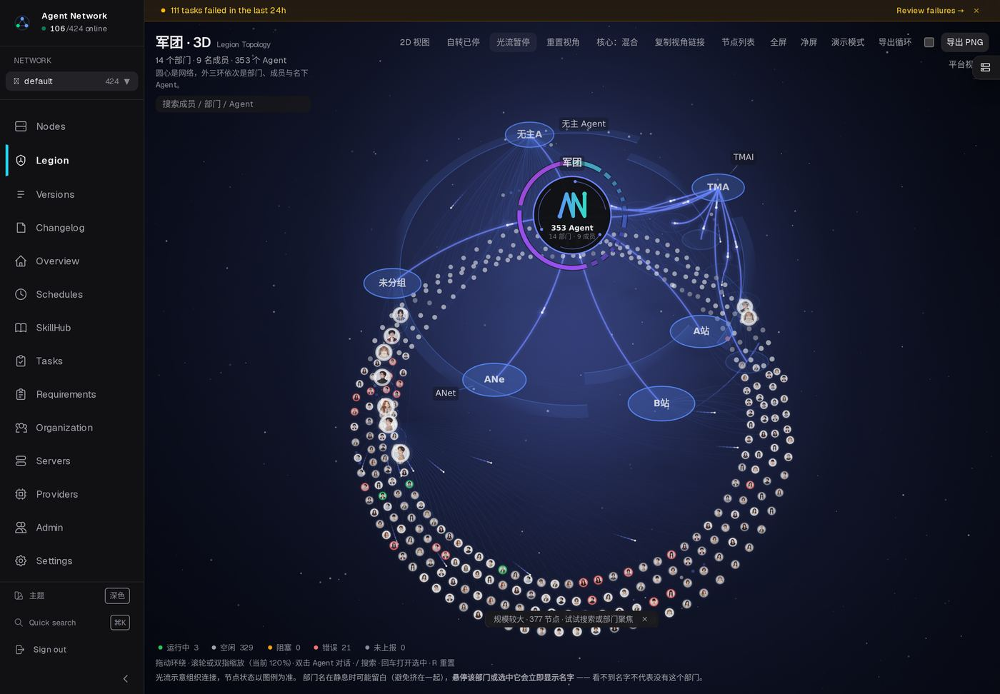

# 军团 3D 俯角对照（`.556` 线上实拍）

当前默认俯角是 `0.85 rad`（≈49°）。这个值是为「三层部门看得见落差」抬上去的定稿值，
但它同时压低了「立体塔」的体量感。本页把三个角度并排放在一起，供定稿判断。

拍图条件：真实数据、关闭自转与光流、`introState=done` 后再等 2.5s、1440×1000 @2x。
想自己切：`/legion/3d?pitch=0.55`（0.2–1.45 区间有效，只影响 canvas 绘制，不改 DOM 结构）。

## 31°（`?pitch=0.55`，接近原始设计意图 25–30°）



## 40°（`?pitch=0.70`）


## 49°（`?pitch=0.85`，当前默认）


## 量化对照（同一次采集，1440）

| 俯角 | zoom | 环纵向高度 | 标签数 | 标签重叠对数 |
|---|---|---|---|---|
| 0.55（≈31°） | 1.202 | 716px | 4 | **0** |
| 0.70（≈40°） | 1.202 | 717px | 4 | **0** |
| 0.85（≈49°） | 1.202 | 716px | 4 | **0** |

```
三个角度的取景缩放与标签可读性完全一致（0 重叠），差别只在观感：
低角度环呈更扁的椭圆、层级落差被压缩；高角度更接近正圆、三层落差更清楚。
⇒ 这是纯取向问题，没有"哪个更正确"，取决于要"体量感"还是"分层清楚"。
```
