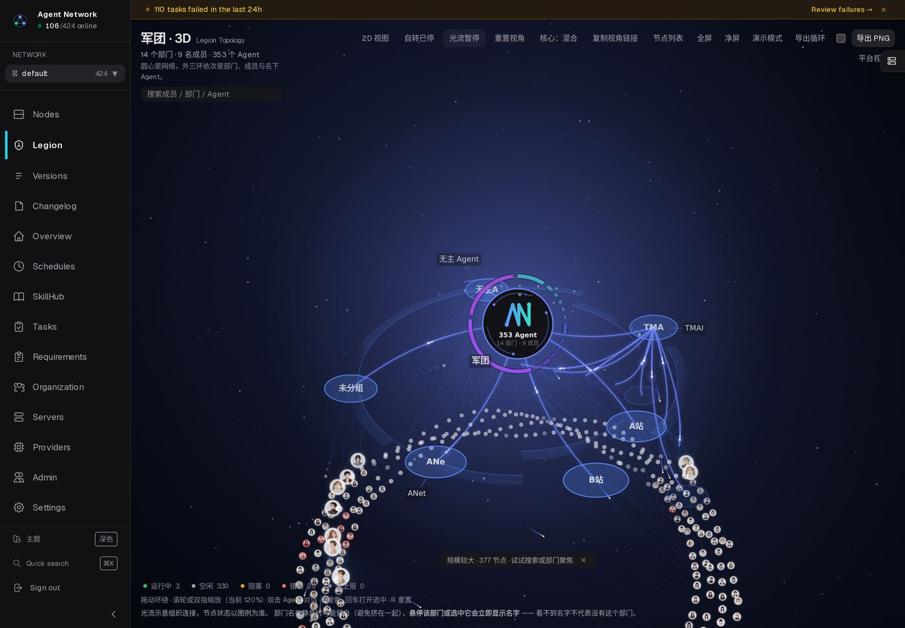
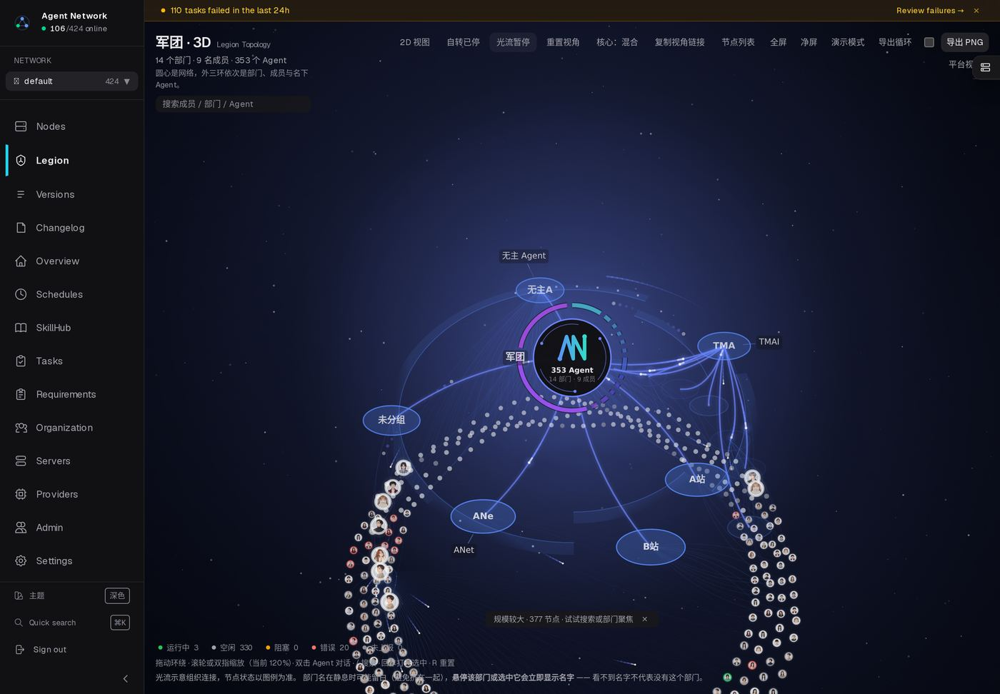
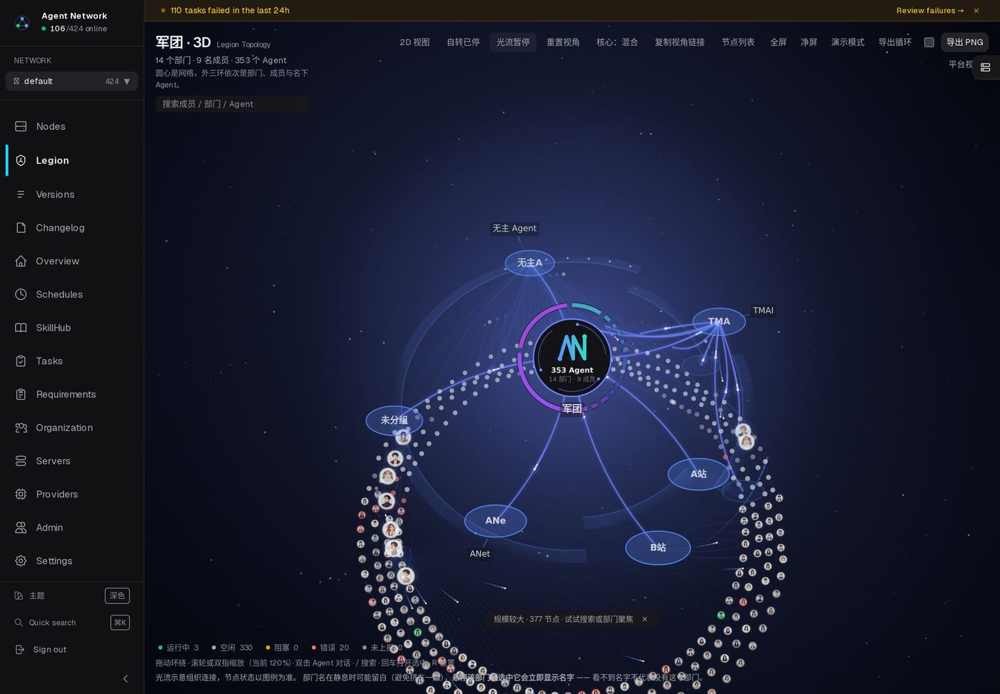

# 军团 3D 俯角对照（`.556` 线上实拍，正确通道版）

当前默认俯角 `0.85 rad`（≈49°）。本页用**能真正改变俯角的通道**拍了三档，供定稿判断。

> 方法说明（`.559` 更新）：`?pitch=` 已修好并可在本页直接使用 ——
> `/legion/3d?pitch=<rad>`。修前它只在"窄屏 / 有保存视角 / 有分享链接"三条支路被读取，
> 桌面首次访问永远读不到（实测 0.20/0.85/1.40 三档的环高宽比 0.927/0.928/0.929，跨度 0.002）。
> 现在两条通道等价：`?pitch=0.20` → 0.714 与 `?view=…,0.20,…` → 0.711 一致。
> 若只想比较俯角、不动 zoom，仍推荐 `?view=yaw,pitch,zoom`；`?pitch=` 会连带触发按新俯角重新取景。
> 拍图条件：真实数据、关闭自转与光流、`introState=done` 后停 2.5s、1440×1000 @2x。

## 低：`pitch=0.55`（≈31°，接近原始设计意图）



## 中：`pitch=0.75`（≈43°）



## 高：`pitch=0.95`（≈54°，比当前默认更俯视）



## 量化对照（同一次采集，1440，`?view` 通道）

| 俯角 | 全体环包围盒 | 标签数 | 标签重叠 |
|---|---|---|---|
| 0.55（≈31°） | 699 × 788 | 4 | **0** |
| 0.75（≈43°） | 645 × 742 | 4 | **0** |
| 0.95（≈54°） | 609 × 690 | 4 | **0** |

```
包围盒随俯角单调收窄（699→645→609），说明角度确实生效；
三档标签重叠均为 0 —— 在这个数据规模下，降俯角不会带来标签可读性代价。
差别在观感：低角度环更扁、体量感更强；高角度更接近正圆、层级落差更清楚。
```

## 附：`?pitch=` 为什么不能用（已登记为待办）

```
极端值实测：?pitch=0.20 与 ?pitch=1.45 的同一层环投影长宽比 0.929 / 0.930（应差 5 倍）；
常规值 0.55/0.70/0.85 的包围盒逐像素一致（643×734）。
⇒ PITCH_PARAM 在运行时没有生效，需查 viewRef 初始化 / saved view 恢复 / reset 路径的覆盖顺序。
~~用 ?view 可绕过；但若要长期支持"参数调俯角"，仍需修 ?pitch。~~
**已修（`.559`）**：`?pitch=` 三处收口（初始化 / 分享链接 / 末尾分支），默认画面零变化；
线上六档实测跨度 0.278、与 `?view` 通道数值一致。
```
