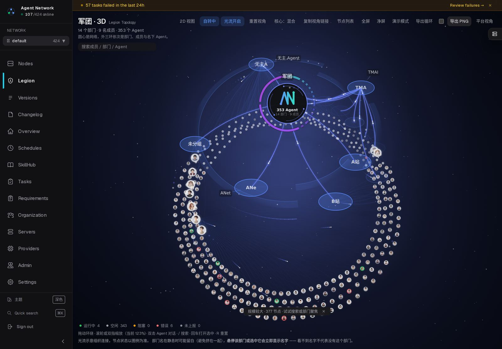
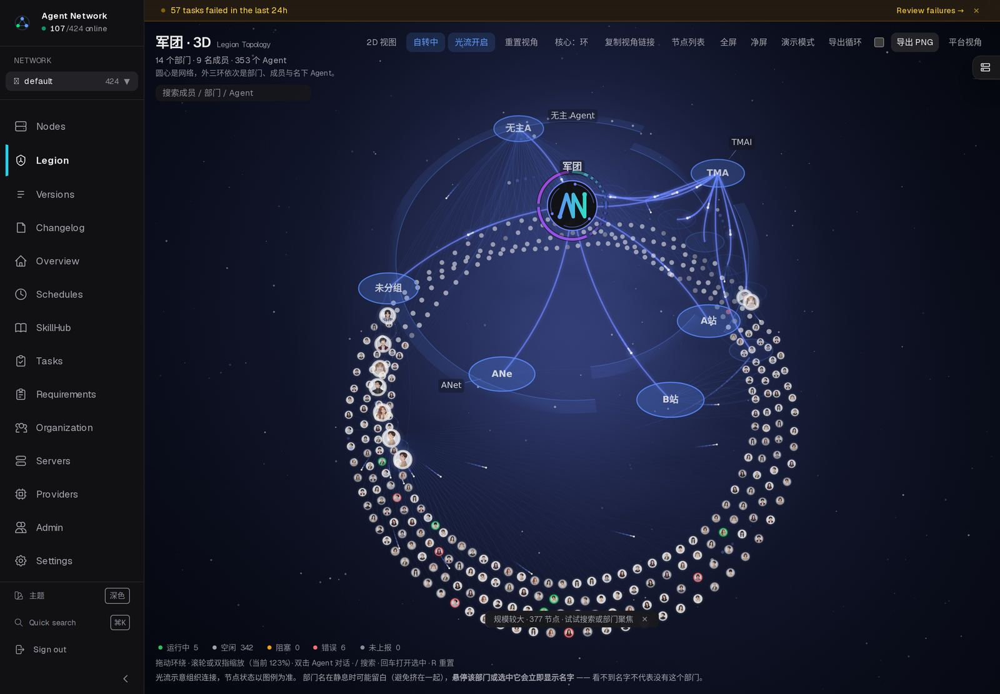
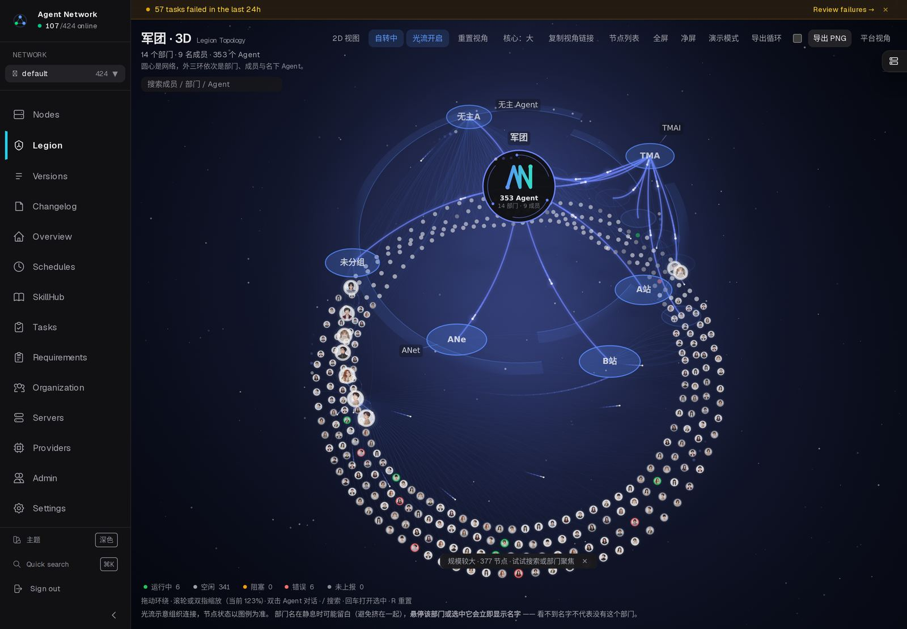
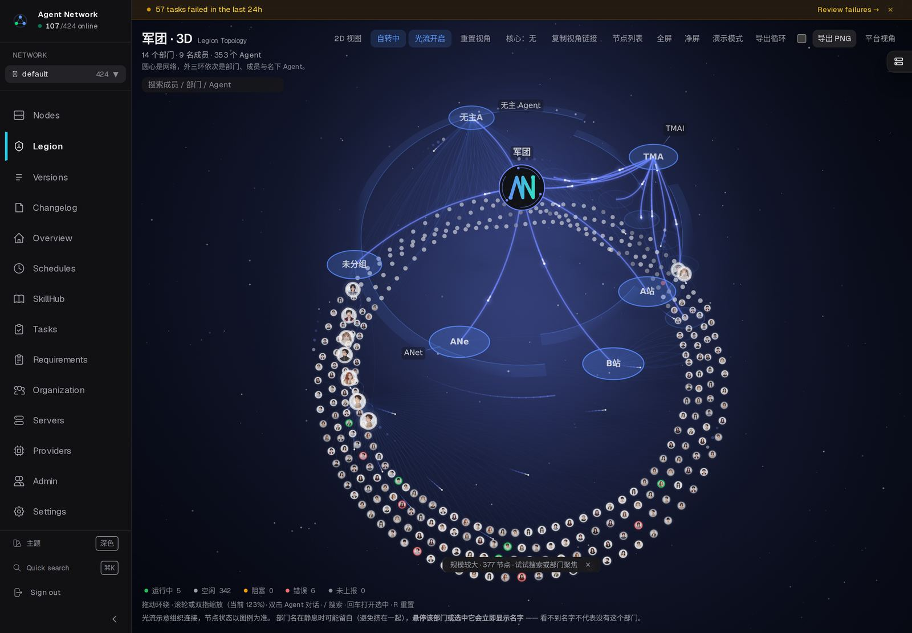
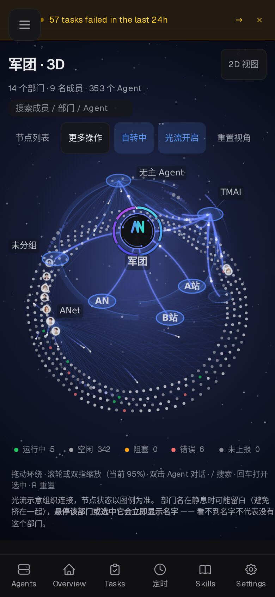

# 军团 3D · 中心区四方案实拍（线上 `.544`）

这四个变体控制的是**中心区**怎么画，其余（外三环布局、成员头像、部门胶囊、光流、状态环）完全相同。
拍图条件：真实数据、`canvas.dataset.introState === 'done'` 之后停 1.2s 再截、1440×1000 @2x。

想自己切：`/legion/3d?core=both|big|ticks|off`。控制栏「核心：混合」按钮也能循环，选择会记住。

## 混合（默认）

大核心（规模数字嵌在环内）+ 部门刻度环。`.538` 起为默认。

## 刻度环

标准核心 + 部门刻度环，中心区信息量最小。

## 大核心

核心环放大 1.6×，规模数字进环内，刻度和外环都退让。

## 干净核心

只留核心徽标与规模，不加刻度与数字。

## 移动端（390）

窄屏下控制栏收成「节点列表 / 更多操作 / 自转 / 光流 / 重置视角」，2D 视图固定在右上角。

## 为什么默认是「混合」

`docs/legion-3d-status.md` 记录了完整对比。结论只留两条**能区分**的判据：

| 判据 | 混合 | 刻度环 |
|---|---|---|
| 画布文字对比度 | 8.75 | 5.95 |
| 320 宽标签留存 | 6/7 | 6/7 |

冷启动与 fps 经测在噪声内（同变体 2.7–8.4s、fps ±6%），**不作为选择依据**。
缩放/平移由同一份相机状态驱动，四个变体之间切换不会丢视角。

## 桌面工具栏（`.544`）

`.543` 的线上实拍发现，1440/1280/1024 下工具栏会换行，「2D 视图」单独掉到第二行贴最右。
`.544` 把它排回单行：`1080p` 在桌面只留复选框、低频控件收内边距、`2D 视图` 在 ≥1280 排到工具栏最左。

| 视口 | `.543` | `.544` |
|---|---|---|
| 1440 | [13, 1] 孤儿 | **[14] 单行**（866px / 可用 918px） |
| 1280 | [11, 3] | [12, 2] |
| 1024 | [8, 6] | [8, 6] |
| 390 | [1, 7] | [1, 7]（原设计） |
