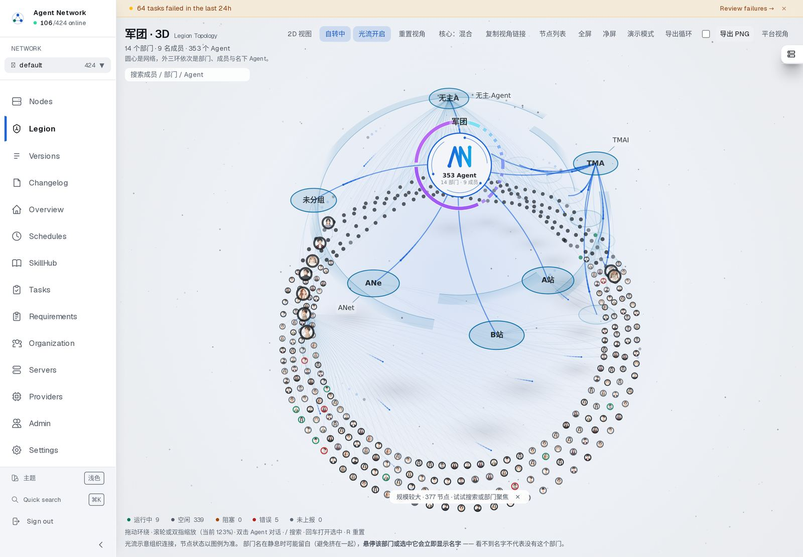
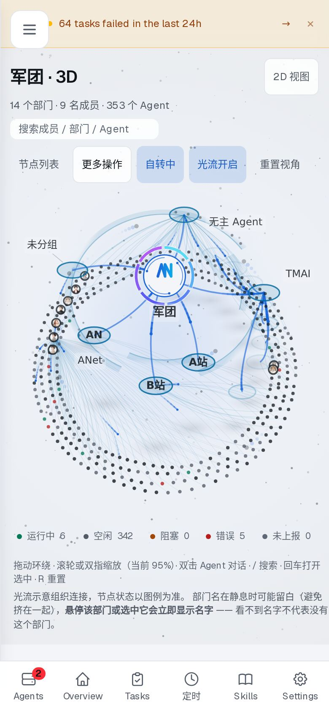

# 军团 3D · 中心区四方案实拍（线上 `.544`）

这四个变体控制的是**中心区**怎么画，其余（外三环布局、成员头像、部门胶囊、光流、状态环）完全相同。
拍图条件：真实数据、`canvas.dataset.introState === 'done'` 之后停 1.2s 再截、1440×1000 @2x。

想自己切：`/legion/3d?core=both|big|ticks|off`。控制栏「核心：混合」按钮也能循环，选择会记住。

## 混合（默认）


大核心（规模数字嵌在环内）+ 部门刻度环。`.538` 起为默认。

## 刻度环


标准核心 + 部门刻度环，中心区信息量最小。

## 大核心


核心环放大 1.6×，规模数字进环内，刻度和外环都退让。

## 干净核心


只留核心徽标与规模，不加刻度与数字。

## 移动端（390）


窄屏下控制栏收成「节点列表 / 更多操作 / 自转 / 光流 / 重置视角」，2D 视图固定在右上角。

## 为什么默认是「混合」

`docs/legion-3d-status.md` 记录了完整对比。结论只留两条**能区分**的判据：

| 判据 | 混合 | 刻度环 |
|---|---|---|
| 画布文字对比度 | 8.75 | 5.95 |
| 320 宽标签留存 | 6/7 | 6/7 |

冷启动与 fps 经测在噪声内（同变体 2.7–8.4s、fps ±6%），**不作为选择依据**。
缩放/平移由同一份相机状态驱动，四个变体之间切换不会丢视角。

## 桌面工具栏（`.544`）

`.543` 的线上实拍发现，1440/1280/1024 下工具栏会换行，「2D 视图」单独掉到第二行贴最右。
`.544` 把它排回单行：`1080p` 在桌面只留复选框、低频控件收内边距、`2D 视图` 在 ≥1280 排到工具栏最左。

| 视口 | `.543` | `.544` |
|---|---|---|
| 1440 | [13, 1] 孤儿 | **[14] 单行**（866px / 可用 918px） |
| 1280 | [11, 3] | [12, 2] |
| 1024 | [8, 6] | [8, 6] |
| 390 | [1, 7] | [1, 7]（原设计） |

## 取景会跟着界面变化重算（`.545`）

军团按「安全区」取景 —— 安全区是画布减去页头与页脚提示区之后的矩形。
`.545` 之前只在安全区**变小**时重取景；变大时不重算，于是任务失败横幅消失、
页脚提示少一行之后，画面仍停在按旧边界算出来的尺寸上。

线上实测（1440，删掉页脚第二行让安全区变大）：

| | 安全区 | zoom | 环高 |
|---|---|---|---|
| `.544` | 135..864 | 1.231（不变） | 726px |
| `.545` | 135..884 | **1.263** | **746px** |

同一操作在 `.544` 上完全没反应，在 `.545` 上立刻重新取景。阈值 8px，避免字体落位抖动导致画面反复呼吸；
用户手动拖过/缩放过视角时不抢机位。

## 浅色主题





画布配色也走主题分支：浅色下成员点变深灰、连线加深、星野收敛。
画布里的字（部门名 / 核心规模数字）不受 DOM 对比度体检覆盖，所以单独用像素探针量：

| 视口 | 变体 | 最低对比度 | 低于 3:1 |
|---|---|---|---|
| 1440 深色 | 四个变体 | 7.50 – 8.86 | 无 |
| 1440 浅色 | 四个变体 | 7.39 – 8.81 | 无 |
| 390 深色 | 四个变体 | 6.90 – 7.48 | 无 |
| 390 浅色 | 四个变体 | 6.67 | 无 |

判据 ≥4.0（像素估算偏保守，实测全集 6.67–8.86）。
`deploy/health-all.sh` 的 `legion-canvas-text` 门自 `.546` 起 **深色与浅色都跑**。

## 2D 军团页的取景规则（`.548`）

2D 页（`/legion`）和 3D 页共用同一份布局数据，但取景是各自实现的，规则不同：

| 场景 | 规则 |
|---|---|
| 容器「宽而矮」（桌面 1024/1280，`高 ≤ 宽`） | `k = min(宽约束, 高约束)` —— 高度也参与，避免把图放大到被上下裁掉 |
| 容器「窄而高」（手机 390） | 只按宽度取景（`k ≈ 1.32`），保持原设计 |
| 舞台高度 | 派生：视口 − 舞台顶部 − 下方内边距 − 4，下限 420（不再写死 `100dvh − 9.5rem`） |
| 重置视角 | 直接恢复「自动取景快照」，不重新计算 |

重置为什么用快照：重新计算会因标签字号有下限（不随缩放等比变化）导致包围盒折算偏差 —— 实测
打开时 `k=1.320`，重算得到 `1.398`，先设 `k=1` 再取景则停在 `1.000`。

线上实测（`.548`，1440 / 1280 / 1024 / 390）：

| 视口 | 整页溢出 | 被裁节点 | 缩放 |
|---|---|---|---|
| 1440 | 0 | 0 | 100% |
| 1280 | 0 | 0 | 100% |
| 1024 | 0 | 0 | — |
| 390 | 140（移动端允许滚动） | 0 | 132% |

## 中心区三变体复测（`.559`，线上，1440 核心区 4 倍放大）

```
node evidence/probes/core-variants.mjs https://dm.vansin.top evidence/<outDir>
⟶ 每个变体输出全图 + 核心区 4 倍放大图 + readings.md（结构量）
```

| 变体 | coreRx（桌面） | 刻度环 | 环内规模数字 | 读数特征 |
|---|---|---|---|---|
| 默认（`?core=` 不带） | 55.5 | 有（15 段） | **有两行** | `coreBig=1, coreTicks=15` |
| `?core=big` | 55.5 | 无 | 有两行 | `coreBig=1, coreTicks=null` |
| `?core=ticks` | 34.5 | 有（15 段） | **无** | `coreBig=null, coreTicks=15` |

```
看 4 倍放大图得到的结论（不是从读数推的）：
  · 默认（混合）信息最全：AN 徽记 + 「353 Agent」+「15 部门 · 9 成员」+ 外缘部门刻度弧
  · big：少了刻度弧，画面更干净，但"哪些部门、各占多宽"读不出来
  · ticks：刻度弧最清楚，但**核心缩到 34.5px，环内两行数字不再绘制**（代码条件 CORE_BIG && radiusPx>=26）
          ⇒ 若把它设为默认，登录第一眼会看不到 Agent 总数 —— 而那是这个页面最想让人看到的数字
⇒ 建议保持「混合」为默认；ticks 适合做"部门分布"专题视图而不是首页
```

尺寸/边距：三变体 labelMargin 桌面 148–149px、窄屏 35px，均 ≥ LABEL_PAD(12)，无塌陷。

> 数据漂移提示：本次读数里部门数已是 **15**（`.556` 调参时为 14），Agent 353、成员 9 未变。
> 取景安全性判据（drift-clip）已包含"规模 vs 基线"一行，规模变化时会被显式报出来。
